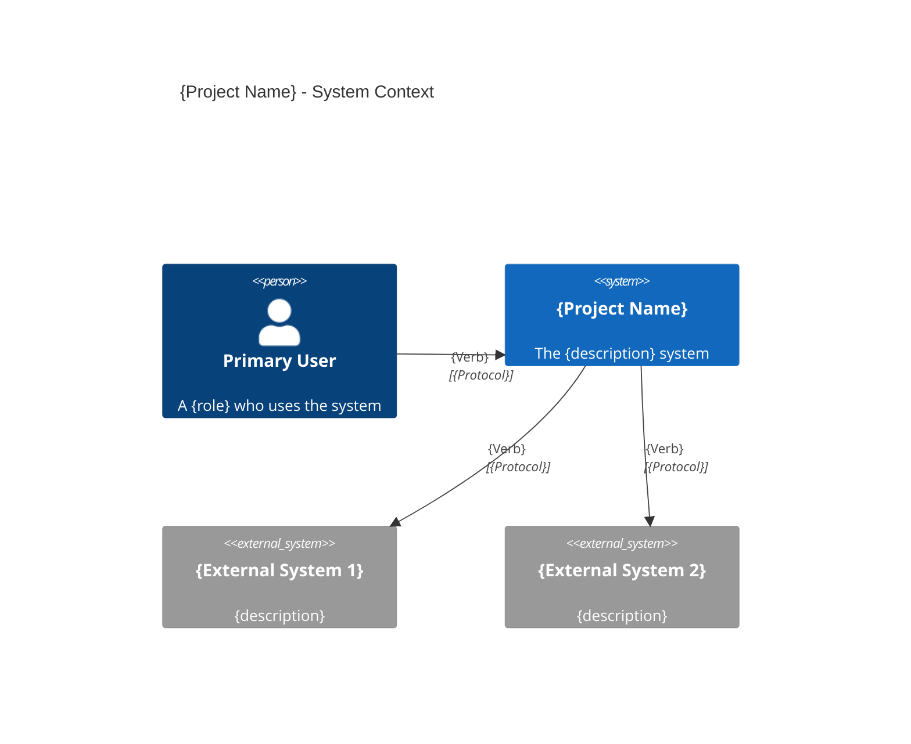

# System Context

> C4 Context Model — Where the system sits in the wider world

**Last Updated:** {YYYY-MM-DD}

---

## Context Diagram



---

## Actors

### Primary Users

| Actor | Description | Goals |
|-------|-------------|-------|
| {User 1} | {Role and description} | {Primary goals} |
| {User 2} | {Role and description} | {Primary goals} |

### Secondary Users

| Actor | Description | Goals |
|-------|-------------|-------|
| {User 3} | {Role and description} | {Primary goals} |

---

## External Systems

### {External System 1}

**Purpose:** {What this system provides}

**Owner:** {Who owns/operates this system}

**Interaction:**
- **Trigger:** {When we interact}
- **Direction:** {We call them / They call us}
- **Protocol:** {How we communicate}
- **Data:** {What data is exchanged}

**SLA:**
- **Availability:** {Uptime target}
- **Latency:** {Response time target}

### {External System 2}

**Purpose:** {What this system provides}

**Owner:** {Who owns/operates this system}

**Interaction:**
- **Trigger:** {When we interact}
- **Direction:** {We call them / They call us}
- **Protocol:** {How we communicate}
- **Data:** {What data is exchanged}

**SLA:**
- **Availability:** {Uptime target}
- **Latency:** {Response time target}

---

## System Boundaries

### In Scope

{What this system is responsible for}

- {Responsibility 1}
- {Responsibility 2}

### Out of Scope

{What this system is NOT responsible for}

- {Not our responsibility 1} — {Who handles it}
- {Not our responsibility 2} — {Who handles it}

---

## Key Interactions

### {Interaction 1}: User → System

**Purpose:** {What the user achieves}

**Steps:**
1. {Step 1}
2. {Step 2}

**Success Criteria:** {What makes this successful}

**Failure Mode:** {What happens on failure}

### {Interaction 2}: System → External System

**Purpose:** {Why this interaction exists}

**Steps:**
1. {Step 1}
2. {Step 2}

**Success Criteria:** {What makes this successful}

**Failure Mode:** {What happens on failure / fallback}

---

## Data Flows

### {Flow 1}: {Description}

```mermaid
flowchart LR
    User[User] --> System[{Project Name}]
    System --> Ext[{External System}]
    Ext --> System
    System --> User
```

**Data exchanged:** {What flows through}

**Synchronization:** {Sync / Async}

**Volume:** {Expected throughput}

### {Flow 2}: {Description}

```mermaid
flowchart LR
    System[{Project Name}] --> Ext[{External System}]
```

**Data exchanged:** {What flows through}

**Synchronization:** {Sync / Async}

**Volume:** {Expected throughput}
