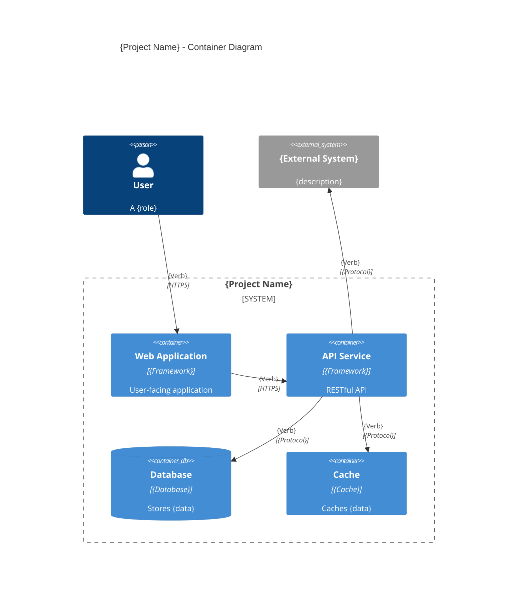
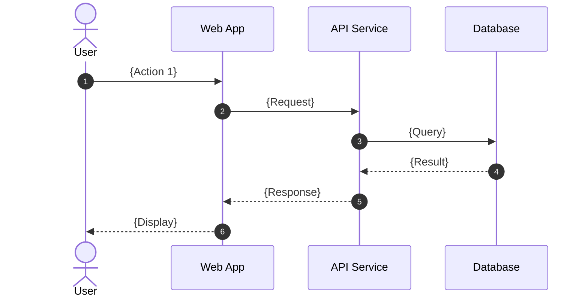
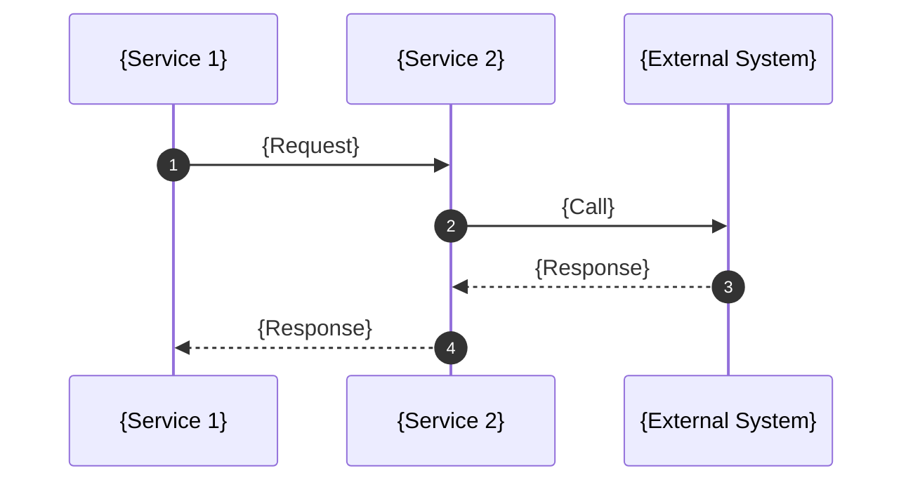
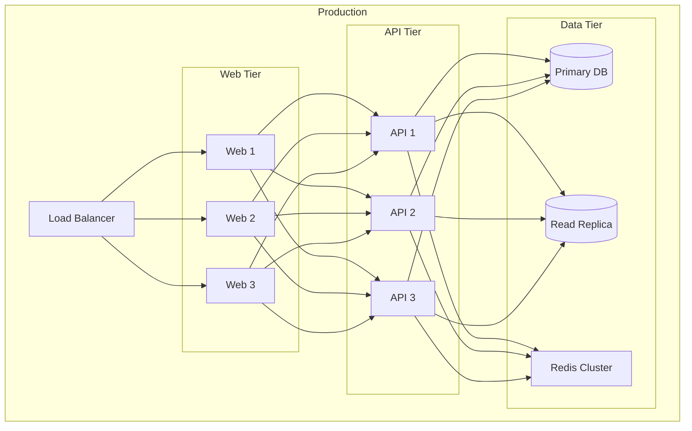
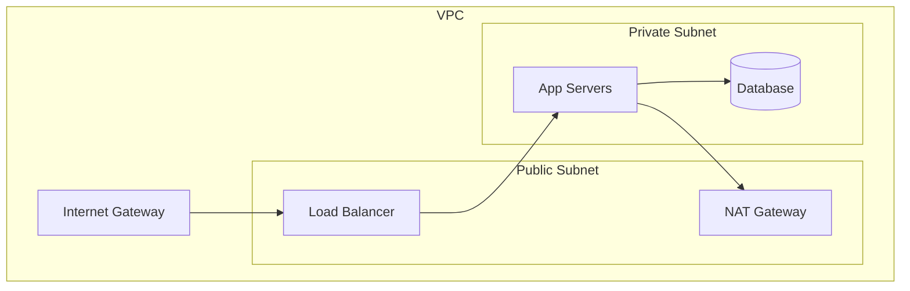

# Architecture Diagrams

> C4 Model diagrams showing system architecture at multiple levels

**Last Updated:** {YYYY-MM-DD}

---

## Level 1: Context

See `CONTEXT_MAP.md` for the system context diagram.

---

## Level 2: Container



### Container Descriptions

| Container | Description | Technology | Responsibilities |
|------------|-------------|------------|------------------|
| {Container 1} | {What it does} | {Tech stack} | {Key responsibilities} |
| {Container 2} | {What it does} | {Tech stack} | {Key responsibilities} |

### Container Interactions

| From | To | Verb | Protocol | Data |
|------|----|----|----------|------|
| {Container 1} | {Container 2} | {Action} | {Protocol} | {What's exchanged} |
| {Container 2} | {Container 3} | {Action} | {Protocol} | {What's exchanged} |

---

## Level 3: Component

### {Container Name} Components

```mermaid
C4Component
    title {Container Name} - Component Diagram

    Container(c1, "{Container Name}", "{description}") {
        Component(ui, "UI Layer", "{Framework}", "User interface")
        Component(api, "API Layer", "{Framework}", "API endpoints")
        Component(domain, "Domain Layer", "{Language}", "Business logic")
        Component(infra, "Infrastructure", "{Language}", "External integrations")
    }
    
    ContainerDb(db, "Database", "{Database}")
    
    Rel(ui, api, "{Verb}")
    Rel(api, domain, "{Verb}")
    Rel(domain, infra, "{Verb}")
    Rel(infra, db, "{Verb}")
```

### Component Descriptions

| Component | Description | Responsibilities |
|------------|-------------|------------------|
| {Component 1} | {What it does} | {Key responsibilities} |
| {Component 2} | {What it does} | {Key responsibilities} |

---

## Sequence Diagrams

### {Scenario 1}: {Description}



### {Scenario 2}: {Description}



---

## State Diagrams

### {Entity}: State Machine

```mermaid
stateDiagram-v2
    [*] --> {State 1}: {Event 1}
    {State 1} --> {State 2}: {Event 2}
    {State 2} --> {State 3}: {Event 3}
    {State 3} --> {State 1}: {Event 4}
    {State 1} --> [*]: {Event 5}
    {State 2} --> [*]: {Event 6}
```

---

## Deployment Diagram



### Infrastructure Details

| Tier | Instance Type | Count | Storage |
|------|---------------|-------|---------|
| Web | {Instance type} | {Count} | {N/A} |
| API | {Instance type} | {Count} | {N/A} |
| DB | {Instance type} | {Count} | {Size} |
| Cache | {Instance type} | {Count} | {Size} |

---

## Network Diagram



### Network Details

| Network | CIDR | Purpose |
|---------|------|---------|
| {Network 1} | {CIDR} | {Purpose} |
| {Network 2} | {CIDR} | {Purpose} |
