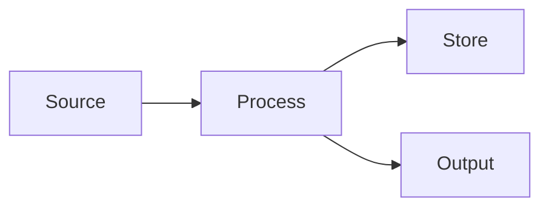
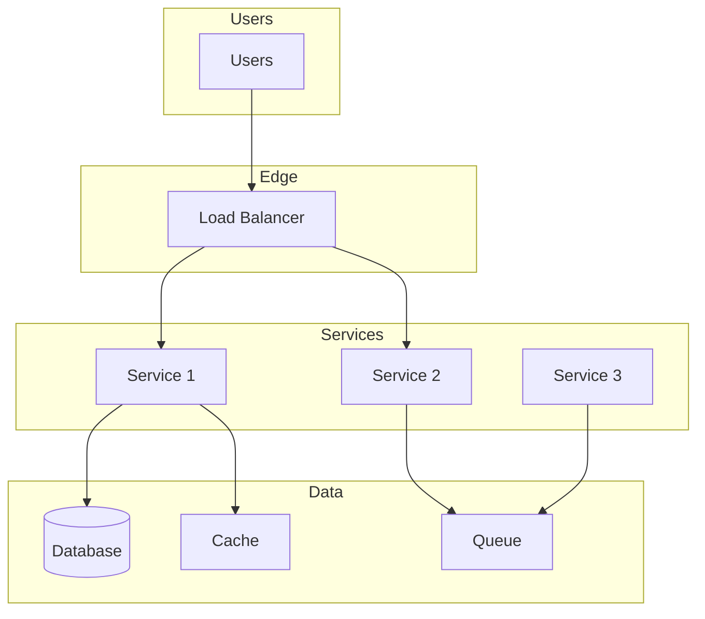

# Architecture Overview

> Five-axis architecture overview of {Project Name}

**Last Updated:** {YYYY-MM-DD}

---

## Executive Summary

{3-4 sentences: What is this system? Who is it for? What are the core capabilities?}

---

## Axis 1: Functional View

### Core Functions

| Function | Description | Priority |
|-----------|-------------|----------|
| {Function 1} | {What it does} | {P0/P1/P2} |
| {Function 2} | {What it does} | {P0/P1/P2} |

### User Interactions

{How users interact with the system}

- {Interaction 1} — {Description}
- {Interaction 2} — {Description}

### External Integrations

{How the system integrates with external services}

| System | Purpose | Protocol |
|---------|---------|----------|
| {System 1} | {Why we integrate} | {How we integrate} |
| {System 2} | {Why we integrate} | {How we integrate} |

---

## Axis 2: Information View

### Data Entities

| Entity | Description | Attributes | Relationships |
|--------|-------------|------------|---------------|
| {Entity 1} | {What it represents} | {Key attributes} | {Related entities} |
| {Entity 2} | {What it represents} | {Key attributes} | {Related entities} |

### Data Flow

{How data moves through the system}



### State Management

{What state is managed and where}

| State | Location | Lifecycle |
|-------|----------|------------|
| {State 1} | {Where it's stored} | {When it's created/destroyed} |
| {State 2} | {Where it's stored} | {When it's created/destroyed} |

---

## Axis 3: Deployment View

### Deployment Architecture



### Infrastructure Components

| Component | Purpose | Technology |
|-----------|---------|------------|
| {Component 1} | {What it does} | {How it's built} |
| {Component 2} | {What it does} | {How it's built} |

### Deployment Strategy

- **Environments:** {Dev / Staging / Prod}
- **Deployment method:** {CI/CD / Manual / Blue-Green / Canary}
- **Scaling:** {Horizontal / Vertical / Auto-scaling}

---

## Axis 4: Technology View

### Technology Stack

| Layer | Technology | Version | Purpose |
|-------|------------|---------|---------|
| Language | {Language} | {Version} | {Primary development} |
| Framework | {Framework} | {Version} | {Web framework} |
| Database | {Database} | {Version} | {Persistence} |
| Cache | {Cache} | {Version} | {Caching layer} |
| Queue | {Queue} | {Version} | {Async processing} |
| Frontend | {Frontend} | {Version} | {UI framework} |

### Key Libraries

| Library | Version | Purpose |
|---------|---------|---------|
| {Library 1} | {Version} | {Why it's used} |
| {Library 2} | {Version} | {Why it's used} |

### Technology Decisions

See ADR (Architecture Decision Records) in `adr/` for detailed rationale.

---

## Axis 5: Developer View

### Code Organization

```
src/
├── {module-1}/        # Bounded Context 1
│   ├── domain/        # Domain models
│   ├── application/   # Use cases
│   └── infrastructure/ # External concerns
├── {module-2}/        # Bounded Context 2
│   ├── domain/
│   ├── application/
│   └── infrastructure/
└── shared/            # Shared code
```

### Development Workflow

1. {Development step 1}
2. {Development step 2}
3. {Development step 3}

### Build & Test

| Command | Purpose |
|---------|---------|
| `{build}` | {What it does} |
| `{test}` | {What it does} |
| `{lint}` | {What it does} |
| `{typecheck}` | {What it does} |

### Local Development

- **Prerequisites:** {What's needed to run locally}
- **Setup:** {How to get started}
- **Common tasks:** {Frequently used commands}

---

## Cross-Cutting Concerns

### Security

{Security architecture at a glance}

- {Security measure 1}
- {Security measure 2}

See `security.md` in guides for details.

### Observability

{Monitoring, logging, tracing}

| Concern | Implementation |
|---------|----------------|
| Logging | {How logging works} |
| Metrics | {What metrics are collected} |
| Tracing | {How distributed tracing works} |
| Alerts | {What triggers alerts} |

### Resilience

{How the system handles failures}

- {Resilience pattern 1}
- {Resilience pattern 2}

---

## Quality Attributes

| Attribute | Target | How it's Measured | Current |
|-----------|--------|------------------|---------|
| Performance | {Target} | {Measurement} | {Current} |
| Scalability | {Target} | {Measurement} | {Current} |
| Availability | {Target} | {Measurement} | {Current} |
| Security | {Target} | {Measurement} | {Current} |
| Maintainability | {Target} | {Measurement} | {Current} |

---

## Evolution

### Planned Changes

| Change | Impact | Timeline |
|--------|--------|----------|
| {Change 1} | {What's affected} | {When} |
| {Change 2} | {What's affected} | {When} |

### Technical Debt

| Debt | Impact | Planned Paydown |
|------|--------|-----------------|
| {Debt 1} | {Impact} | {When to fix} |
| {Debt 2} | {Impact} | {When to fix} |
