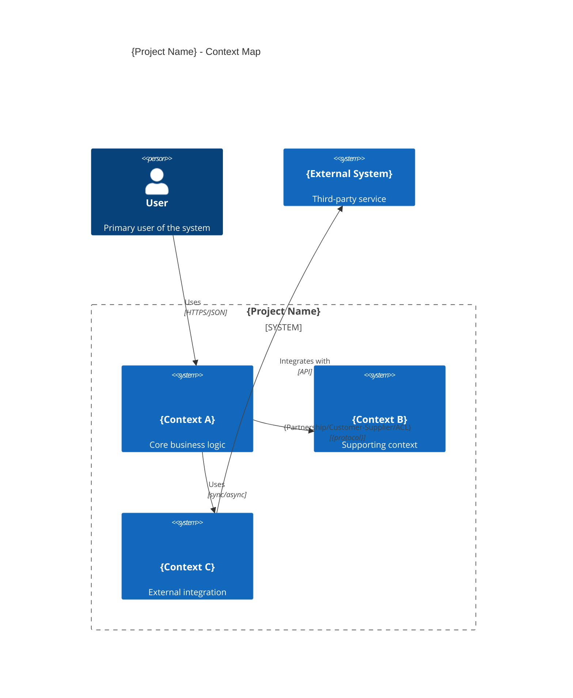

# Context Map

> Visual representation of bounded contexts and their relationships.

**Last Updated:** {YYYY-MM-DD}

---

## C4 Context Map

---

## Relationship Details

### {Context A} ↔ {Context B}

**Relationship Type:** {Partnership / Customer-Supplier / Conformist / ACL / Shared Kernel}

**Upstream Context:** {Which one is upstream?}

**Downstream Context:** {Which one is downstream?}

**Interaction:**
- **Trigger:** {What initiates communication}
- **Direction:** {Request / Response / Event}
- **Protocol:** {REST / gRPC / Events / Shared DB}
- **Data Format:** {JSON / Protobuf / etc.}

**Service Level Agreement:**
- **Availability:** {e.g., 99.9% uptime}
- **Latency:** {e.g., p95 < 100ms}
- **Throughput:** {e.g., 1000 req/sec}

**Error Handling:**
- **Retry Policy:** {How retries work}
- **Fallback:** {What happens on failure}
- **Circuit Breaker:** {Circuit breaking threshold}

---

### {Context A} ↔ {External System}

**Relationship Type:** {Partnership / Customer-Supplier / Conformist / ACL / Open Host Service}

**Owned By:** {Our team / External team / Third-party}

**Interaction:**
- **Trigger:** {What initiates communication}
- **Direction:** {We call them / They call us / Bi-directional}
- **Protocol:** {REST API / GraphQL / Webhook / etc.}

**Contract:**
- **API Version:** {Which version}
- **Authentication:** {How we authenticate}
- **Rate Limits:** {Any rate limits}

**Error Handling:**
- **Timeout:** {Request timeout}
- **Retry Policy:** {How retries work}
- **Fallback:** {What happens on failure}

---

## Context Collaboration Patterns

| Context A | Context B | Pattern | Channel | Notes |
|------------|-----------|---------|---------|-------|
| {Context A} | {Context B} | {Request/Response, Event, Replication} | {HTTP/Message Queue/Shared DB} | {Notes} |
| {Context B} | {Context C} | {Request/Response, Event, Replication} | {HTTP/Message Queue/Shared DB} | {Notes} |

---

## Anti-Corruption Layers (ACL)

| External Context | ACL Context | Translation Logic | Owner |
|------------------|-------------|-------------------|-------|
| {External} | {Our Context} | {How we translate} | {Team} |

---

## Shared Kernels

| Context A | Context B | Shared Model | Governance |
|-----------|-----------|--------------|------------|
| {Context A} | {Context B} | {What's shared} | {Who owns changes} |

---

## Communication Matrix

| Context | {Context A} | {Context B} | {Context C} | {External} |
|---------|-------------|-------------|-------------|------------|
| **{Context A}** | — | {Protocol, Frequency} | {Protocol, Frequency} | {Protocol, Frequency} |
| **{Context B}** | {Protocol, Frequency} | — | {Protocol, Frequency} | {Protocol, Frequency} |
| **{Context C}** | {Protocol, Frequency} | {Protocol, Frequency} | — | {Protocol, Frequency} |

**Legend:**
- **Sync:** HTTP/REST, gRPC, GraphQL
- **Async:** Message queue, event bus, webhook
- **Frequency:** Real-time / Hourly / Daily / On-demand

---

## Deployment Boundaries

| Context | Deployment Unit | Can Deploy Independently? |
|---------|-----------------|--------------------------|
| {Context A} | {Service / Library / Module} | {Yes/No} |
| {Context B} | {Service / Library / Module} | {Yes/No} |
| {Context C} | {Service / Library / Module} | {Yes/No} |

---

## Data Ownership

| Data Entity | Owning Context | Readable By | Writable By |
|-------------|-----------------|-------------|-------------|
| {Entity A} | {Context A} | {Contexts} | {Context A only} |
| {Entity B} | {Context B} | {Contexts} | {Context B only} |
| {Shared Entity} | {Shared Kernel} | {Contexts} | {Context A, Context B} |

---

## Evolution

### Proposed Changes

| Change | Context(s) | Impact | Timeline |
|---------|------------|--------|----------|
| {Change 1} | {Affected contexts} | {Impact} | {When} |

### Decommissioning

| Context | Target End Date | Replacement | Migration Plan |
|---------|-----------------|-------------|----------------|
| {Context} | {Date} | {New context} | {How to migrate} |
